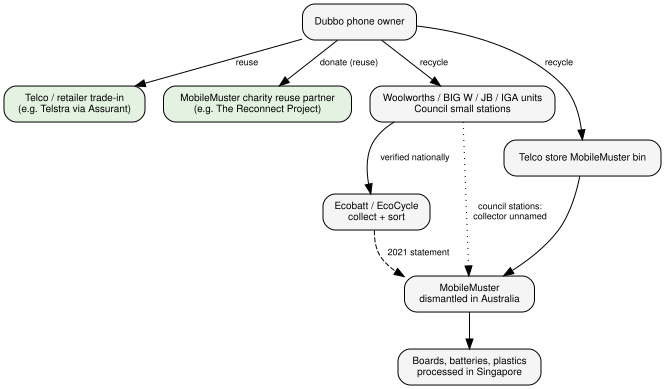
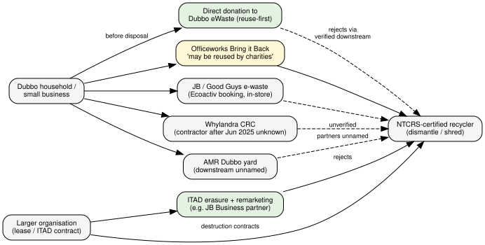
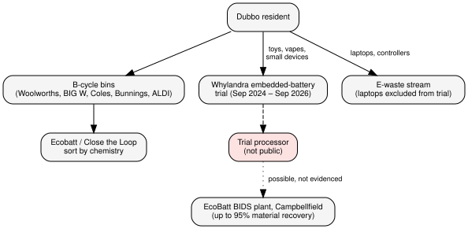

# EcoCycle, EcoBatt and Dubbo's e-waste supply chain — second-pass research and verification

**28 November 2026 AEDT.** Executes the public desk-research component of the [research prompt](ECOCYCLE-DUBBO-SUPPLY-CHAIN-RESEARCH-PROMPT-2026-11-28.md) as an independent second pass. Not legal advice. No company, council or agency has been contacted and no correspondence has been sent. Stakeholder sequencing and private context are kept in the private ResearchAtlas archive, not here.

**Read alongside the companion report.** A separate session published the [EcoBatt / EcoCycle Dubbo supply-chain investigation](ECOBATT-ECOCYCLE-DUBBO-RESEARCH-2026-11-28.md) on the same day. The two were researched independently and largely agree. This pass cross-checks it, adopts the primary sources it could reach that this pass couldn't, and adds evidence it doesn't cover (phones to MobileMuster, MobileMuster's reuse-partner model, Officeworks' reuse route, the Whylandra embedded-battery trial, EcoCycle's NTCRS tonnage, and a ranked partnership assessment). See [section 0](#0-how-this-pass-relates-to-the-companion-report).

**Method limits.** Web search was available; direct page retrieval was not available for part of this session. Where the companion report read a primary page this pass couldn't, the claim is marked **CORROBORATED** and cites that primary page. Every claim carries an evidence ID (E01–E51) that maps to the [evidence register](../data/ecocycle-dubbo-2026-11-28/evidence-register.csv) and to `EVD-ECO-*` records in [data/evidence.yaml](../data/evidence.yaml).

Status labels: **VERIFIED** (primary or published evidence read in this pass) · **CORROBORATED** (primary source read by the companion report, not re-read here) · **PARTIAL** (some of the claim supported) · **UNVERIFIED** (not established) · **INFERENCE** (reasoned from verified facts, not stated by anyone).

---

## Bottom line

1. **The preliminary finding holds — for EcoCycle's own service.** EcoCycle publicly positions itself as a physical-destruction recycler rather than one that wipes and on-sells computers (E04), and Eco E-Waste's secure-disposal page says it doesn't refurbish or resell (E05, corroborated). That is a company service policy, not proof that every device in every contract is destroyed. Screenshot the page with a date before quoting it.
2. **EcoCycle is not where most Dubbo computers go.** Its visible Dubbo footprint is retail **battery and phone bins** (Woolworths, Coles, Bunnings and similar), not computer collection (E13, E16, E17, E45). Ecocycle's whole national NTCRS collection in FY23/24 was about **85 tonnes** (E08). Dubbo's computers enter through Whylandra, AMR, Officeworks, JB Hi-Fi/The Good Guys and business ITAD.
3. **For phones, the reuse window closes at the bin slot.** Woolworths and BIG W units are serviced by EcoBatt/EcoCycle; in 2021 Woolworths said phone components go on to MobileMuster (E13–E15), whose then-manager said none of its phones are resold (E22). BIG W explicitly prohibits retrieving deposited devices (E15). Asking to divert phones from these bins is the wrong ask (E46).
4. **The useful EcoCycle conversation is downstream, not diversion.** EcoCycle claims AS 5377 and R2v3 certification (E07) and runs a national battery network and the Campbellfield BIDS plant (E10). That makes it a candidate **certified destination for Dubbo eWaste's rejects and batteries** — which helps close the downstream gate (G3 in the [AMR results](AMR-DUBBO-REUSE-PARTNERSHIP-RESEARCH-RESULTS-2026-11-25.md)).
5. **Best phone-reuse model found: become a MobileMuster reuse partner.** MobileMuster already works with charities such as The Reconnect Project, which refurbish what they can while MobileMuster recycles the rest (E23).
6. **Best computer interception points: Officeworks first, then JB/Good Guys.** Officeworks says Bring it Back items may be reused by charities where appropriate (E25) and it partners with Circonomy and Moorup (E26). AMR remains the primary local partner track; Council stays on **HOLD** (E31).
7. **Policy is moving, law hasn't yet.** The Productivity Commission's final report (released 16 Jan 2026) repeats the call for NTCRS reuse and repair targets (E33, E34), and co-regulators themselves say the scheme doesn't reward reuse (E39). The NTCRS still measures material recovery, now under the National EPA (E32).
8. **Scale check:** 5,000 devices a year is roughly **3 full-time people** under the planning assumptions below. The back-shed pilot is realistically a 100–500 device-a-year operation.

---

## 0. How this pass relates to the companion report

| Topic | Companion report | This pass | Net position |
| --- | --- | --- | --- |
| Eco E-Waste "no refurbish/resell" policy | Read the secure-disposal page | Couldn't retrieve; found EcoCycle's own physical-destruction statement | Agreed (E04, E05) |
| Legal structure | EcoBatt and ecoe-waste are business names of Ecocycle Pty Ltd (ABR) | Group self-description, leadership, 2014 acquisition | Agreed; use the ABR framing (E47) |
| PC submission 217 | Read p3: reform and audit before reuse targets; destruction expectations | Confirmed it exists; PC interim finding on destroyed functional products; WorkVentures and ANZRP views | Agreed (E33–E39) |
| Facilities | St Marys EPL 21136; Reo Crescent BIDS hub; WA site routes laptops/phones to BIDS; new Qld grant | BIDS funding and capacity; NTCRS FY23/24 tonnage (85 t) | Complementary (E08, E10, E41, E42, E48, E51) |
| Retail streams | BIG W, Woolworths, Coles, Bunnings, JB, Good Guys, Harvey Norman, ALDI, telcos | Same, plus Woolworths → MobileMuster detail, IGA/Mitre 10, Officeworks charity reuse, Moorup, Circonomy | Complementary |
| Council | Waste Strategy contract table; CRC battery contractors | Whylandra EPA embedded-battery trial; council small stations | Complementary (E28–E30, E49) |
| Phones | MobileMuster materials recovery | MobileMuster: none resold (2019); reuse-partner model (Reconnect) | This pass adds a lawful phone reuse lane (E21–E23) |
| Partnership direction | Opt-in reuse stream before surrender; EcoCycle partnerships approach | Same principle; ranks EcoCycle **as certified downstream** above any diversion ask | Compatible; see section 9 |
| Scenario model | Variable-cost model, 15/35/60% yield, $40/h | AMR-consistent model incl. erasure, 30/60/80% yield, $30/h, FTE | Both show yield decides viability and 5,000/yr is a staffed operation; see section 8 |

---

## 1. Claim check — the preliminary summary

| Preliminary claim | Verdict | Evidence |
| --- | --- | --- |
| Eco E-Waste states it does not resell or refurbish any e-waste | **CORROBORATED** — secure-disposal page read by companion report; matches EcoCycle's own destruction statement | E05, E04 |
| Its policy is to physically destroy equipment received for recycling | **PARTIAL** — stated for its secure-disposal service and data-bearing items; a blanket rule across every contract isn't shown | E04, E05 |
| EcoCycle Group is owned by the Rowe family | **PARTIAL** — Doug Rowe leads the group; Recycal is described as family-owned; group shareholding not checked | E02, E03 |
| Group = EcoBatt, Eco E-Waste, EcoCycle, Recycal, Castings Tasmania, ACL Metal Powders | **VERIFIED**, plus **EcoBatt Safety**; EcoBatt and ecoe-waste are business names of Ecocycle Pty Ltd | E01, E47 |
| EcoCycle is a government-approved NTCRS participant | **VERIFIED** (approved co-regulatory arrangement) | E09, E08 |
| BIDS plant opened 3 Sep 2025, Campbellfield, $2m Victorian funding, up to 95% recovery | **VERIFIED** | E10 |
| BIG W — national EcoBatt partnership | **CORROBORATED** — BIG W page names EcoBatt/EcoCycle | E15 |
| Woolworths — national EcoBatt partnership | **VERIFIED** | E13 |
| Coles — EcoBatt collection partnership | **VERIFIED** (with Close the Loop) | E16 |
| JB Hi-Fi — EcoBatt collection partnership | **CORROBORATED** — Eco E-Waste names JB bins; booked e-waste is via Ecoactiv | E18 |
| The Good Guys — EcoBatt batteries; separate computer arrangements | **CORROBORATED** for separate computer/TV route (Ecycle Solutions listing in Dubbo); EcoBatt battery link unconfirmed | E19 |
| Dubbo Council previously contracted Matthews Metals for e-waste | **VERIFIED** (30 June 2023 – 30 June 2025) | E31, E49 |
| EcoCycle's 2025 PC submission argued to fix the NTCRS before reuse targets; customers want destruction | **CORROBORATED** (No. 217, 11 Apr 2025, p3) | E35, E36 |
| EcoCycle NSW at 22 Christie St, St Marys; 02 9833 4155 | **CORROBORATED** site (EPL 21136); phone unverified | E41 |
| Head office 5–11 Reo Crescent, Campbellfield | **CORROBORATED** as the battery sorting/BIDS hub address | E42 |

---

## 2. EcoCycle Group — corporate picture

EcoBatt and ecoe-waste are **registered business names of Ecocycle Pty Ltd (ABN 76 146 190 516)**, so treat them as brands of one company rather than separate subsidiaries until ASIC records say otherwise (E47).

| Entity / brand | Role (company description) | Evidence |
| --- | --- | --- |
| EcoCycle (Ecocycle Pty Ltd) | Hazardous waste, mercury recovery, battery and e-waste recycling; NTCRS co-regulatory arrangement; Victorian grant project lead | E01, E08, E09, E11 |
| EcoBatt (business name) | Battery and phone collection network (claims ~7,500 drop-off points, own fleet); BIDS plant operator | E10, E12, E47 |
| EcoBatt Safety | Listed group business (scope not researched) | E01 |
| Eco E-Waste (business name) | Electronics recycling with national pick-up and robotic hazardous-part removal; secure disposal by destruction | E05, E06, E47 |
| Recycal | Metals recycling (Tas, Vic); described as family-owned | E03 |
| Castings Tasmania; ACL Metal Powders | Steel castings; copper-based powders (use recovered metals) | E01 |

- **Leadership (publicly quoted):** Doug Rowe (Group CEO/MD), Nick Dodd (EcoCycle GM), Tom Susen (Group Risk and Compliance), Spyro Kalos (National Partnerships Manager ANZ; formerly MobileMuster's manager) (E02, E24).
- **History:** in 2014 the Ecocycle business name and assets were bought from receivers of CMA Recycling and placed under Nick Dodd and Doug Rowe's management (E03).
- **Sites named publicly:** Campbellfield (Vic, 5–11 Reo Crescent, battery sorting and BIDS), Gillman (SA, AS/NZS 5377 per FY23/24 report), Rocherlea (Tas), Kwinana (WA), Auckland (NZ), and St Marys (NSW, 22 Christie Street, EPL 21136) (E08, E41, E42). A WA regulator decision shows the WA site sending embedded-battery devices — including laptops, tablets and phones — to the Campbellfield BIDS plant (E48). That's a WA route; no Dubbo shipment has been traced.
- **Pipeline:** Queensland announced a $10m grant for an EcoBatt all-chemistries battery plant at Hemmant on 26 November 2026 (E51) — planned, not operating.
- **Certification claims:** AS 5377; R2v3 (April 2025). The certificates' sites and scope were not inspected. R2v3 is a reuse-and-recycling standard, so ask which process scopes EcoCycle holds — certification alone doesn't mean it tests or refurbishes (E07, Q05).
- **Funding:** $2m (CEIF Hazardous Waste Round 3) for the BIDS plant, and a separate $2.5m 2024 announcement for a lithium battery plant. Don't merge the two without confirming they're the same project (E10, E11).
- **NTCRS footprint:** FY23/24 collection 85,333 kg against a 77,466 kg target (E08). That's small for a co-regulator, which supports the view that EcoCycle isn't Dubbo's main computer route.
- **Don't confuse with:** **Ecycle Solutions** (a QLS Group subsidiary and separate NTCRS co-regulator, historically using Harvey Norman/Good Guys drop-offs) (E20); **Ecoactiv** (JB Hi-Fi e-waste partner) (E18); the unrelated US Eco-Cycle and Holcim's ECOCycle brand.
- **Not done this session:** ABNs, directors, ASIC structure, EPA licence register entries, procurement records. These need registry queries (Q19).

---

## 3. Dubbo collection network

National partnerships are **not** proof of what a Dubbo store does. Store presence is verified for Officeworks, JB Hi-Fi Home, BIG W/Woolworths (Orana Mall), Harvey Norman and The Good Guys (E27). Coles, ALDI, Bunnings, IGA/Mitre 10 and telco stores weren't checked.

| Collection point | Accepts | Known partner | Reuse signal |
| --- | --- | --- | --- |
| Woolworths | Batteries, phones, accessories, wearables | Ecobatt/EcoCycle → MobileMuster (2021) | None; "delete your data" |
| BIG W | Batteries, phones, chargers, modems, wearables; Toys for Joy | EcoBatt/EcoCycle; MobileMuster referenced | None; retrieval prohibited |
| Coles | Batteries | Close the Loop + Ecobatt | None |
| Bunnings | Batteries (no embedded-battery products) | Ecobatt | None |
| JB Hi-Fi Home | Batteries, phones; booked e-waste; trade-in; business ITAD | Eco E-Waste (bins); Ecoactiv; Assurant (trade-in); JB Business ITAD partner (Blancco) | Trade-in, business buyback |
| The Good Guys | Small e-waste, batteries; TV cages (some stores); trade-in | Ecycle Solutions (Dubbo TV/computer listing) | Trade-in |
| **Officeworks** | IT equipment, phones, cartridges; trade-in | Certified recyclers; MobileMuster; Moorup; Circonomy | **Charity reuse "where appropriate"** |
| Harvey Norman | E-waste at participating stores | Ecycle Solutions (Dubbo participation unconfirmed) | Unknown |
| Telco stores | Phones, modems (MobileMuster); trade-in | MobileMuster; Assurant (Telstra) | Trade-in |
| Whylandra CRC | Household e-waste; embedded-battery trial; problem waste | Contractor after June 2025 unknown | None public |
| Council small stations | Phones, smoke alarms, cartridges | Not named | None |
| AMR Dubbo | E-waste excluding lithium-ion | Downstream unnamed | See AMR track |

Full directory with sources: [collection-network.csv](../data/ecocycle-dubbo-2026-11-28/collection-network.csv).

---

## 4. Device-by-device pathways

Solid lines are evidenced; dashed lines are stated but old or unconfirmed for Dubbo; dotted lines are possibilities only. Green boxes are reuse routes.

**Phones and tablets**

**Computers**

**Batteries and small embedded-battery devices**

| Category | Dubbo entry points | Tested before destruction? | Realistic reuse window |
| --- | --- | --- | --- |
| Desktops, gaming PCs, workstations | Whylandra, AMR, Officeworks, booked e-waste, ITAD | Unknown at council/AMR; ITAD tests by design | Donor offer before disposal; Officeworks charity reuse; ITAD |
| Laptops, Chromebooks, MacBooks | As above; trade-in | Trade-in grades; bins don't | Trade-in; pre-collection donation |
| Phones, tablets | Retail units, telco stores, Officeworks, council stations | No (MobileMuster: none resold) | Trade-in; MobileMuster charity partners |
| Servers, networking | Business ITAD; modems via telco bins | ITAD-dependent | Business ITAD/donation |
| GPUs, RAM, CPUs, boards | Whylandra, AMR, Officeworks | No evidence of harvesting | Before drop-off only |
| HDDs, SSDs | Inside the above | Destroyed in destruction streams; erased in ITAD | Erasure-based ITAD only |
| POS, self-checkouts, scanners | Retailer asset disposal | Unknown | Asset owner's decision |
| Printers, monitors, TVs | Whylandra, AMR, Good Guys cages, Officeworks | Unknown | Before drop-off |
| Smartwatches, consoles, toys | Woolworths units, MobileMuster, Whylandra trial, Toys for Joy | No | Before deposit |
| Chargers, cables, batteries | B-cycle bins, council stations, MobileMuster | n/a | Cables/chargers before deposit |

Important details: the NSW EPA embedded-battery trial at Whylandra (Sept 2024 – Sept 2026) **excludes NTCRS products such as laptops**, which go to e-waste (E29). In WA, EcoCycle sends battery-bearing laptops, tablets and phones to BIDS shredding (E48), so a working laptop that reaches EcoCycle can end up shredded whole — another reason to intercept before surrender. Who processed the trial material, and whether it continued after September 2026, isn't public (Q11). Full table: [device-pathways.csv](../data/ecocycle-dubbo-2026-11-28/device-pathways.csv).

---

## 5. Separate streams, separate owners

| Stream | Who owns it at the decision point | Who could authorise an alternative | Default for Dubbo eWaste |
| --- | --- | --- | --- |
| 1. Customer recycling bins | Retailer/recycler after deposit (legal title not established, Q16) | Retailer + recycler, and arguably only with depositor consent | **REJECT** — don't ask |
| 2. Retailers' own retired IT | Retailer (or lessor) | Retailer IT/asset management | Potential — approach as ITAD donor |
| 3. Customer returns | Retailer / supplier (return-to-vendor terms) | Supplier contracts | HOLD |
| 4. Warranty replacements | Manufacturer/insurer | Manufacturer | HOLD |
| 5. Damaged or non-saleable stock | Retailer/supplier | Retailer; existing donation partners (e.g. BIG W uses Good360 for surplus goods) | Potential, via existing donation channels |
| 6. Unsold clearance stock | Retailer | Retailer | Out of scope (new goods) |
| 7. Insurance write-offs | Insurer | Insurer/salvage contracts | HOLD |
| 8. Commercial ITAD | Customer organisation | Customer's asset owner + ITAD contract | Potential — strongest |
| 9. Council-collected household e-waste | Council, then contractor | Council (declined 20 Oct 2026) | **HOLD** |
| 10. Manufacturer take-back / NTCRS | Co-regulator/recycler under scheme rules | Co-regulator in writing, with reporting rules | HOLD |

This aligns with the [source eligibility matrix](AMR-DUBBO-REUSE-PARTNERSHIP-RESEARCH-RESULTS-2026-11-25.md#source-eligibility-decision-matrix): reuse is realistic where an identifiable owner can give written permission **before** an item is surrendered for destruction.

---

## 6. The destruction-first question

**What is established.** EcoCycle markets physical destruction as its data-security approach and contrasts it with wipe-and-resell models (E04). MobileMuster destroys data in disassembly and historically resold none of its phones (E21, E22). The Productivity Commission found the NTCRS recycling focus results in some functional or repairable products being dismantled or destroyed (E33).

**What is not established.** Whether *all* EcoCycle Group streams are destruction-only; whether functional devices are routinely shredded untested; whether contracts allow refurbishment exceptions or let clients choose certified erasure; whether any reuse trial has happened (Q01, Q02, Q05).

**Why destruction isn't simply a bad policy.** Destruction is a legitimate, often contracted, data-security service; depositors in phone bins were told data would be destroyed; and NTCRS accounting rewards material recovery by weight, not whole-device reuse (see the NTCRS rules analysis in the [AMR results](AMR-DUBBO-REUSE-PARTNERSHIP-RESEARCH-RESULTS-2026-11-25.md)). A recycler can be acting lawfully and rationally while still losing reusable devices.

**Material recovery is not reuse.** "Up to 95% of materials recovered" (E10) describes a shredded device. A working phone that is shredded can count as 95% recovered and 0% reused. Don't let percentages in either direction be read as reuse rates.

**Implication.** The ask to EcoCycle shouldn't be "give us what's in your stream". It should be "where do you see reusable devices arriving, could you route owners to reuse *before* surrender, and will you be our certified downstream?"

---

## 7. Legal and regulatory position

| Instrument / scheme | What it does | Relevance to a reuse-first pathway | Status |
| --- | --- | --- | --- |
| NTCRS — Recycling and Waste Reduction Act 2020, 2021 Rules | Co-regulatory TV/computer recycling; certified recycling; material-recovery targets | Reuse not counted; collected scheme stock is HOLD; donors can reuse before scheme collection | VERIFIED (E32; rules detail in AMR results) |
| National EPA (from 1 July 2026) | Now NTCRS regulator and co-regulator approver | Ask how reuse is treated and reported (Q17) | VERIFIED (E32, E09) |
| Productivity Commission circular economy report | Recommends reuse/repair targets and wider right-to-repair measures | Policy direction only, no legal effect | VERIFIED (E33, E34) |
| NSW Product Lifecycle Responsibility Act 2025 + Regulation 2026 | Mandatory product stewardship; first scheme covers batteries; embedded batteries in policy scope | Affects battery handling route and future obligations; commencement to confirm (Q18) | VERIFIED framework (E37) |
| B-cycle (voluntary accredited) | Household battery collection and recycling | Dubbo eWaste could register as a collection point for its own battery outflows | VERIFIED (E16) |
| MobileMuster (voluntary accredited) | Telco-industry phone recycling | Downstream for phones; reuse-partner model exists | VERIFIED (E21–E23) |
| NSW EPA embedded battery trial | Free CRC drop-off for small embedded-battery devices, to Sep 2026 | Not a reuse channel; laptops excluded | VERIFIED (E29) |
| AS/NZS 5377, R2v3 | Recycler process standards | Look for these in any downstream partner; certification ≠ permission to recover | Claims only (E07) |
| Environment protection licensing | Whylandra holds EPL 6058 | Small refurbisher licensing covered in [LEGAL-LICENSING](LEGAL-LICENSING.md) | Not re-researched |
| Privacy and sanitisation | NIST SP 800-88 Rev 2, ASD ISM | Covered in AMR results and sanitisation workbench docs | Not re-researched |
| Ownership, consumer guarantees, second-hand dealing | Title, ACL guarantees, Fair Trading classification | Covered in [Phase 0 gates](PHASE-0-LAUNCH-GATES.md) and [Council dossier](COUNCIL-WHYLANDRA-APPROVAL-DOSSIER-2026-10-20.md) | Not re-researched |
| Dangerous goods transport | Lithium batteries are regulated goods | Covered in [RESEARCH-06](RESEARCH-06-BATTERY-ELECTRICAL-WORKSHOP-SAFETY.md) | Not re-researched |
| Right to repair, FRP/locks | No general permission to bypass locks | Covered in [FRP and right to repair](FRP-AI-POLICY-RIGHT-TO-REPAIR-2026-11-27.md) | Not re-researched |

**Feasibility verdict:** a separate, consent-based reuse-first pathway is **legally feasible** where an identifiable owner gives written permission before disposal (donor, business ITAD, retailer-owned IT). It is **not realistic** for items already surrendered to recycling bins or scheme collections without the owner's or co-regulator's written authority. No certification gives Dubbo eWaste a right to open bins, take scheme stock or remove device locks.

---

## 8. Sizing the opportunity

**Order of magnitude only.** About 57,400 residents (E43) × roughly 23 kg of e-waste per person (E44) ≈ **1,300 tonnes a year** of all electrical and electronic waste. That's a national average by weight covering whitegoods to vapes — **not** a Dubbo measurement and **not** a device count. No public source gives Dubbo's volumes by stream or the working/repairable share (Q20).

**Planning scenarios (not quotes, not collection statistics).** Same assumptions as the 25 Nov AMR results: $5 acquisition and $12 erasure per input, 30 minutes intake and 45 minutes refurb at $30/hour, $40 parts per released unit, $5 residual handling per reject, $50 per 20-device batch, $150 average sale only if sale is authorised. FTE assumes about 1,650 productive hours a year.

| Inputs/yr | Yield | Released | Labour hours | FTE | Economic cost | Cost per released unit | Sale-model contribution |
| --- | --- | --- | --- | --- | --- | --- | --- |
| 100 | 30% | 30 | 72 | 0.04 | $5,675 | $189 | −$1,175 |
| 100 | 60% | 60 | 95 | 0.06 | $7,400 | $123 | $1,600 |
| 500 | 30% | 150 | 362 | 0.22 | $28,375 | $189 | −$5,875 |
| 500 | 60% | 300 | 475 | 0.29 | $37,000 | $123 | $8,000 |
| 1,000 | 60% | 600 | 950 | 0.58 | $74,000 | $123 | $16,000 |
| 1,000 | 80% | 800 | 1,100 | 0.67 | $85,500 | $107 | $34,500 |
| 5,000 | 30% | 1,500 | 3,625 | 2.20 | $283,750 | $189 | −$58,750 |
| 5,000 | 60% | 3,000 | 4,750 | 2.88 | $370,000 | $123 | $80,000 |

All 12 rows: [scenarios.csv](../data/ecocycle-dubbo-2026-11-28/scenarios.csv). The [companion report](ECOBATT-ECOCYCLE-DUBBO-RESEARCH-2026-11-28.md#5-commercial-model-illustrative-not-actual-volumes) uses a leaner variable-cost model (no acquisition or erasure cost, $40/hour, 15/35/60% yields); its break-even yield is about 24% before fixed costs. The two models differ in assumptions, not conclusions. Use this one when erasure licensing and acquisition fees apply, and the companion's for donated, drive-free stock. Reading the table:

- **Yield decides everything.** At 30% yield every volume loses money on a sale model; upstream sourcing (working devices offered before disposal) is what lifts yield, which is another reason not to chase destruction streams.
- **Donation models need funding equal to the economic cost** — about $123 per donated device at 60% yield.
- **Avoided emissions:** no defensible Dubbo baseline or LCA exists yet, so none is claimed. Measure displaced purchases during the pilot instead.

---

## 9. Partnership models evaluated

| Model | Feasibility | Why | First step |
| --- | --- | --- | --- |
| EcoCycle as certified downstream for Dubbo eWaste rejects and batteries | **High** | Fits EcoCycle's business; closes part of gate G3; no title conflict | Ask Spyro Kalos for terms, certificates, battery acceptance |
| MobileMuster regional reuse partner (Reconnect model) | **Medium–High** | Precedent exists; MobileMuster takes rejects | Ask eligibility and data rules (Q07) |
| Officeworks / Circonomy regional reuse partner | **Medium** | Reuse "where appropriate" is already policy; national partner may not want a small regional one | Ask Dubbo store, then corporate (Q08, Q09) |
| Local ITAD service with documented sanitisation for Dubbo businesses | **Medium** | Owner consent is clean; needs a licensed erasure arrangement (Blancco licensing issue in AMR results) | Resolve erasure licence first |
| Corporate equipment donation programme (retailers' own IT) | **Medium** | Clean title; large retailers usually have national ITAD contracts | Ask local managers who decides |
| Authorised pre-recycling diversion from EcoCycle streams | **Low** | Destruction expectation, contracts, scheme accounting | Don't lead with it |
| Regional collection subcontracting for EcoCycle | **Low** | Needs transport, storage and licensing scale | Revisit after pilot |
| Component harvesting with written approval | **Low** | Data and title complications; little value outside donor stock | Only from donor stock |
| Dubbo regional circular electronics pilot (multi-party) | **Medium, later** | Needs Council, which declined on 20 Oct | Bring pilot evidence back to Council and NetWaste |

---

## 10. Recommended sequence

1. **This week:** screenshot Eco E-Waste's secure-disposal page with a date (Q01) so the policy is on file before it's quoted externally.
2. **Send the EcoCycle downstream enquiry** (draft in [templates](../templates/ecocycle-mobilemuster-officeworks-enquiry-drafts-2026-11-28.md)) — frame it as "certified destination and battery route", not stock diversion.
3. **Send the MobileMuster reuse-partner enquiry** — this gives phones a lawful reuse lane with a downstream already attached.
4. **Visit Officeworks Dubbo** and ask who handles Bring it Back and the charity-reuse decision; photograph bin signage at Woolworths, BIG W, JB and Good Guys while in Orana Mall/Cobra St (Q04, Q08, Q12, Q13).
5. **Keep AMR as the main local track** and Council on HOLD; send only an information request to Council about the current contractor (Q10).
6. **Run the pilot from donor and business-ITAD stock** to measure real yield, hours and outcomes before scaling past a few hundred devices.

---

## 11. Stakeholder directory (public professional contacts only)

| Organisation | Role / person (public) | Contact (public) | Purpose |
| --- | --- | --- | --- |
| EcoCycle Group | National Partnerships Manager ANZ — Spyro Kalos | Website form; 1300 32 62 92 | Downstream terms; Dubbo servicing facts |
| EcoCycle Group | Risk and Compliance Manager — Tom Susen | Via company | Destruction policy, R2v3 scope |
| MobileMuster | Reuse/charity partnerships | Website contact | Reuse-partner eligibility |
| Officeworks Dubbo | Store management | (02) 6883 4700 | Bring it Back handling |
| The Good Guys Dubbo | Store | 02 6841 9444 | E-waste collector; trade-in |
| Dubbo Regional Council | Whylandra / resource recovery | 02 6801 4900; 02 6801 4000 | Information only |
| NSW EPA | Embedded batteries trial | 131 555 | Trial processor; continuation |
| National EPA | NTCRS team | Via nationalepa.gov.au | Reuse treatment under scheme |

Full list with sources and priorities: [stakeholders.csv](../data/ecocycle-dubbo-2026-11-28/stakeholders.csv). Roles were current in the cited sources and may have changed.

---

## 12. Outstanding verification questions

Top priorities (all 20 in [open-questions.csv](../data/ecocycle-dubbo-2026-11-28/open-questions.csv)):

- **Q01** Screenshot Eco E-Waste's secure-disposal page with a date.
- **Q03** Which EcoCycle entity services Dubbo's bins, how often, via which consolidation point?
- **Q05** Does any EcoCycle stream test or grade devices before destruction; what does its R2v3 scope cover?
- **Q06** Would EcoCycle accept Dubbo eWaste's rejects and batteries, on what terms and certificates?
- **Q07** Can a regional organisation become a MobileMuster reuse partner?
- **Q08** Who decides which Officeworks Bring it Back items are reused?
- **Q10** Who is Council's current e-waste contractor?
- **Q20** What share of devices reaching Dubbo collection points actually works or is repairable?

---

## 13. Files in this pack

- This report, and the [research prompt](ECOCYCLE-DUBBO-SUPPLY-CHAIN-RESEARCH-PROMPT-2026-11-28.md) it executes
- [PDF version](../reports/ECOCYCLE-ECOBATT-DUBBO-SUPPLY-CHAIN-2026-11-28.pdf)
- Datasets in [data/ecocycle-dubbo-2026-11-28/](../data/ecocycle-dubbo-2026-11-28/): `evidence-register.csv/.json`, `collection-network.csv`, `device-pathways.csv`, `stakeholders.csv`, `open-questions.csv`, `scenarios.csv`, `sources.json`, `diagrams/`
- Evidence records `EVD-ECO-001`–`EVD-ECO-051` in [data/evidence.yaml](../data/evidence.yaml) (validator passes)
- Companion report: [ECOBATT-ECOCYCLE-DUBBO-RESEARCH-2026-11-28.md](ECOBATT-ECOCYCLE-DUBBO-RESEARCH-2026-11-28.md) and its CSVs in [docs/data/](data/)
- Draft enquiries (not sent): [templates/ecocycle-mobilemuster-officeworks-enquiry-drafts-2026-11-28.md](../templates/ecocycle-mobilemuster-officeworks-enquiry-drafts-2026-11-28.md)
- Rebuild: `python3 scripts/build_ecocycle_dubbo_2026_11_28.py`

Related repo research: [AMR results](AMR-DUBBO-REUSE-PARTNERSHIP-RESEARCH-RESULTS-2026-11-25.md) · [AMR downstream forensic](AMR-DUBBO-DOWNSTREAM-FORENSIC.md) · [What happens to e-waste](WHAT-HAPPENS-TO-EWASTE.md) · [TechCollect reuse deep dive](TECHCOLLECT-REUSE-DEEP-DIVE.md) · [Council Whylandra dossier](COUNCIL-WHYLANDRA-APPROVAL-DOSSIER-2026-10-20.md) · [FRP and right to repair](FRP-AI-POLICY-RIGHT-TO-REPAIR-2026-11-27.md)

---

## Sources

All accessed 28 November 2026. Company and retailer pages are self-descriptions unless stated.

- S01 [EcoCycle — About EcoCycle](https://ecocycle.com.au/?p=6079)
- S02 [Waste Management Review — EcoCycle celebrates 30 years](https://wastemanagementreview.com.au/ecocycle-celebrates-30-years-of-specialist-recycling/)
- S03 [EcoCycle — Ecocycle now under new ownership](https://ecocycle.com.au/ecocycle-now-new-ownership)
- S04 [EcoCycle — Certified destruction](https://ecocycle.com.au/certified-destruction-cma-ecocycle-destroys-personal-information-attached-items-recycled/)
- S05 [EcoCycle — E-waste recycling and mercury recovery](https://ecocycle.com.au/e-waste-recycling-mercury-recovery/)
- S06 [EcoCycle — Safely recycling old hard drives](https://ecocycle.com.au/?p=4687)
- S07 [Waste Management Review — Ecocycle achieves global certification](https://wastemanagementreview.com.au/ecocycle-achieves-global-certification/)
- S08 [Ecocycle Pty Ltd NTCRS annual report FY23/24](https://www.dcceew.gov.au/sites/default/files/documents/ecocycle-ntcrs-annual-report-fy-23-24.pdf)
- S09 [Victorian Premier — First of a kind battery recycling](https://www.premier.vic.gov.au/first-kind-battery-recycling-victoria)
- S10 [Recycling Near You — World-first battery recycling plant opens](https://recyclingnearyou.com.au/news/world-first-battery-recycling-plant-opens-in-melbourne)
- S11 [Resource Recycling — World's first BIDS plant](https://resource-recycling.com/e-scrap/2025/09/11/australia-opens-worlds-first-battery-in-device-shredding-plant/)
- S12 [Sustainability Victoria — Ecobatt funded project](https://sustainability.vic.gov.au/grants-funding-and-investment/grants-and-funding/ecobatts-turnkey-lithium-battery-processing-and-recycling-plant)
- S13 [Victorian Premier — Boosting battery recovery (2024)](https://www.premier.vic.gov.au/boosting-victorias-battery-recovery-industry)
- S14 [Energy Magazine — BMW and BIDS plant](https://www.energymagazine.com.au/bmw-teams-up-with-australian-first-battery-shredding-plant/)
- S15 [EcoCycle — Contact](https://ecocycle.com.au/contact)
- S16 [Business Recycling — CMA Ecocycle St Marys](https://businessrecycling.com.au/business/17917)
- S17 [Woolworths — Battery & mobile phone recycling unit](https://woolworths.com.au/shop/discover/sustainability/recycling-unit)
- S18 [Woolworths Group — 1,000 collection bins (2021)](https://woolworthsgroup.com.au/au/en/our-newsroom/latest-news/2021/woolworths-to-make-battery-recycling-easier-with-national-network-of-1000-collection-bins.html)
- S19 [Woolworths Group — BIG W sustainability progress (2023)](https://woolworthsgroup.com.au/au/en/our-newsroom/media-releases/latest-news/2023/big-w-says-goodbye-to-soft-plastic--shopping-bags-in-nationwide-.html)
- S20 [Woolworths Group — National Recycling Week 2026](https://woolworthsgroup.com.au/au/en/our-newsroom/media-releases/latest-news/2026/national-recycling-week.html)
- S21 [Coles — Battery recycling](https://www.coles.com.au/about/sustainability/our-commitment/battery-recycling)
- S22 [Bunnings — Battery recycling](https://www.bunnings.com.au/qr-cat-f-battery-recycling)
- S23 [IGA — Ecobatt units](https://iga.com.au/?p=19968)
- S24 [Mitre 10 — EcoBATT units](https://www.mitre10.com.au/diy/ecobatts-watt-this-battery-recycling-initiative-can-do-for-you)
- S25 [Recycling Near You — Batteries](https://recyclingnearyou.com.au/batteries)
- S26 [MobileMuster — FAQs](https://www.mobilemuster.com.au/faqs)
- S27 [Waste Management Review, July 2019 — MobileMuster](https://issuu.com/primecreativemedia-2016/docs/wmr0719_lr/s/10446164)
- S28 [MobileMuster — Reuse](https://mobilemuster.com.au/reuse/)
- S29 [Officeworks — Recycling at Officeworks](https://www.officeworks.com.au/information/about-us/sustainability/environment/recycling)
- S30 [Wesfarmers FY2024 — Officeworks circularity](https://www.wesfarmers.com.au/sustainability/fy2024/our-businesses/officeworks/circularity-and-waste)
- S31 [JB Hi-Fi Business — Buyback](https://www.jbhifi.business/services/buyback)
- S32 [JB Hi-Fi — E-waste recycling with Ecoactiv](https://www.jbhifi.com.au/pages/help-and-support/e-waste-recycling-with-ecoactiv)
- S33 [The Good Guys — E-waste & battery recycling](https://www.thegoodguys.com.au/e-waste-recycling)
- S34 [Ecycle Solutions NTCRS annual report 2020](https://www.agriculture.gov.au/sites/default/files/documents/ecycle-solutions-annual-report-2020.pdf)
- S35 [Telstra — Trade-in](https://telstra.com.au/trade-in)
- S36 [Sustainability Matters — Vodafone and MobileMuster](https://www.sustainabilitymatters.net.au/content/waste/news/vodafone-and-mobilemuster-team-up-to-tackle-e-waste-1487183861)
- S37 [Dubbo Regional Council — Council waste facilities](https://www.dubbo.nsw.gov.au/Households-Residents/Rubbish-Recycling-and-Sustainability/council-waste-facilities)
- S38 [Dubbo Regional Council — Whylandra Waste and Recycling Centre](https://www.dubbo.nsw.gov.au/Households-Residents/Rubbish-Recycling-and-Sustainability/whylandra-waste-recycling-centre)
- S39 [Dubbo Regional Council — Weekly Wrap](https://www.dubbo.nsw.gov.au/news-and-media/news-and-resources/council-news/weekly-wrap)
- S40 [NSW EPA — Embedded batteries](https://www.epa.nsw.gov.au/embedded-batteries)
- S41 [NSW EPA — Embedded battery trial launch (2024)](https://www.epa.nsw.gov.au/News/Media-Releases/2024/EPAMedia240926-New-trial-targets-safe-disposal-of-embedded-batteries-including-vapes)
- S42 [DCCEEW — NTCRS](https://www.dcceew.gov.au/environment/protection/waste/product-stewardship/television-computer-recycling-scheme)
- S43 [National EPA — NTCRS co-regulatory arrangements](https://www.nationalepa.gov.au/node/269)
- S44 [Productivity Commission — Circular economy final report](https://www.pc.gov.au/inquiries-and-research/circular-economy/report)
- S45 [Productivity Commission — Interim report](https://assets.pc.gov.au/2025-05/circular-economy-interim.pdf)
- S46 [Productivity Commission — Submissions list](https://www.pc.gov.au/inquiries-and-research/circular-economy/submissions/)
- S47 [NSW Legislation — Product Lifecycle Responsibility Act 2025](https://legislation.nsw.gov.au/view/html/inforce/2025-04-09/act-2025-022/lh)
- S48 [NSW EPA — Regulatory updates](https://epa.nsw.gov.au/Licensing-and-Regulation/Updates)
- S49 [NSW Government — First state to regulate batteries](https://www.nsw.gov.au/ministerial-releases/nsw-leads-way-first-state-to-regulate-batteries)
- S50 [PC submission 089 — WorkVentures](https://pc.gov.au/__data/assets/pdf_file/0006/387465/sub089-circular-economy.pdf)
- S51 [PC submission 195 — ANZRP](https://assets.pc.gov.au/392246/sub195-circular-economy.pdf)
- S52 [Harvey Norman — Dubbo](https://stores.harveynorman.com.au/harvey-norman-dubbo-nsw)
- S53 [The Good Guys — Dubbo](https://www.thegoodguys.com.au/dubbo)
- S54 [Officeworks — Dubbo](https://officeworks.com.au/shop/officeworks/storepage/W218/NSW/Dubbo)
- S55 [Visit NSW — Orana Mall](https://www.visitnsw.com/uk/destinations/country-nsw/dubbo-area/dubbo/attractions/orana-mall-shopping-centre)
- S56 [City Population — Dubbo Regional](https://www.citypopulation.de/en/australia/admin/new_south_wales/12390__dubbo_regional)
- S57 [Officeworks media release, Nov 2021](https://www.Officeworks.Com.Au/resources/pdfs/media-centre/PressRelease_BringitBack_NOV21.pdf)
- S58 [Channel News — emeals](https://www.channelnews.com.au/emeals-turning-your-e-waste-into-free-meals-for-people-in-need/)
- S59 [EcoCycle — Recycal sister operations](https://ecocycle.com.au/?p=6021)

Primary sources read by the companion report and relied on here as **CORROBORATED** (not re-read in this pass):

- C00 [Companion report — EcoBatt/EcoCycle Dubbo investigation](ECOBATT-ECOCYCLE-DUBBO-RESEARCH-2026-11-28.md)
- C01 [ABR — Ecocycle Pty Ltd](https://abr.business.gov.au/ABN/View?id=76146190516)
- C03 [Eco E-Waste — Secure data disposal](https://ecoewaste.com.au/secure-data-disposal/)
- C04 [BIG W — Recycling unit](https://www.bigw.com.au/sustainability/recycling-unit)
- C06 [NSW EPA public register — EPL 21136](https://apps.epa.nsw.gov.au/prpoeoapp/ViewPOEOLicence.aspx?DOCID=211294&LICID=21136&SYSUID=1)
- C08 [EcoBatt — Our site](https://www.ecobatt.com.au/our-site/)
- C12 [Queensland Government statement 106498](https://statements.qld.gov.au/statements/106498)
- C13 [WA DWER decision report L2956/2025/1](https://www.der.wa.gov.au/images/documents/our-work/licences-and-works-approvals/Decisions_/L2956/L2956%2016-10-2025%20DR.pdf)
- C22 [Eco E-Waste — Recycle mobile phones](https://www.ecoewaste.net/recycle-mobile-phones/)
- C25 [Recycling Near You — The Good Guys Dubbo](https://www.recyclingnearyou.com.au/business/14792)
- C27 [Harvey Norman — E-waste](https://www.harveynorman.com.au/e-waste)
- C31 [Dubbo Regional Council — Waste Strategy 2025 (contract table p49)](https://www.dubbo.nsw.gov.au/ArticleDocuments/242/Waste_Strategy_2025_Adopted.pdf.aspx)
- C35 [PC submission 217 — Ecocycle](https://assets.pc.gov.au/392368/sub217-circular-economy.pdf)
